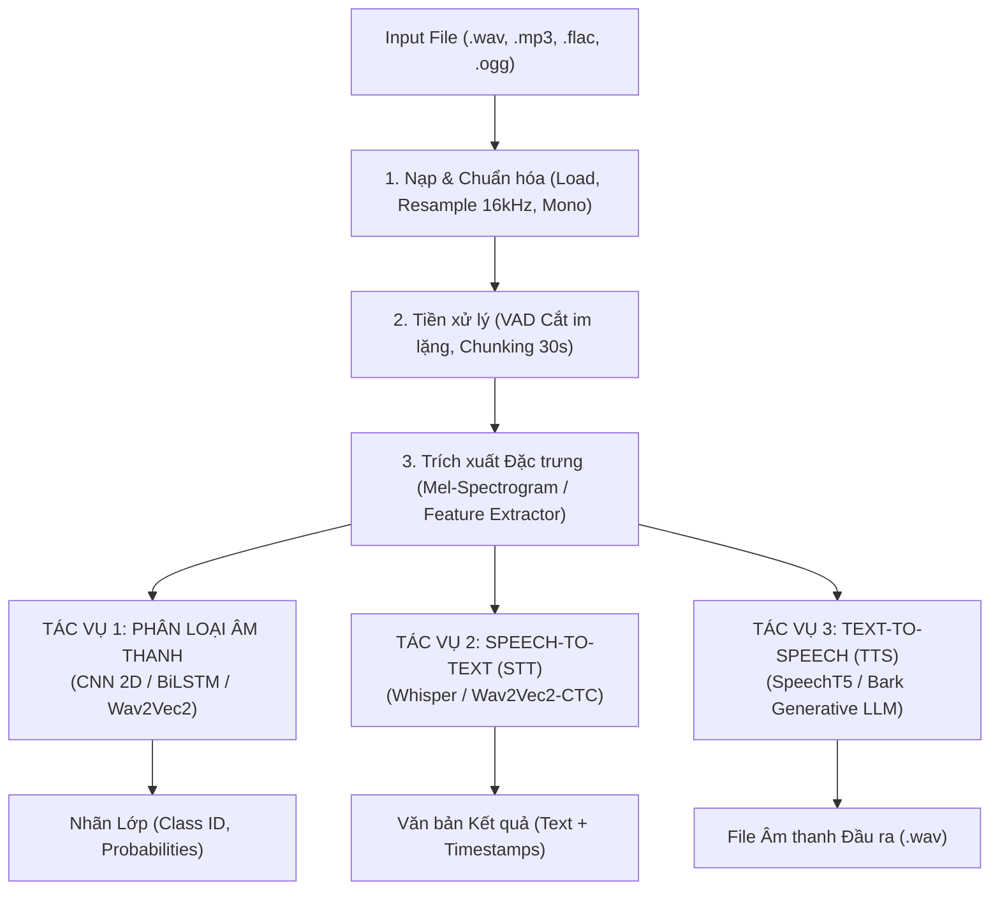
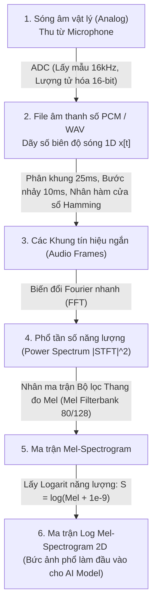
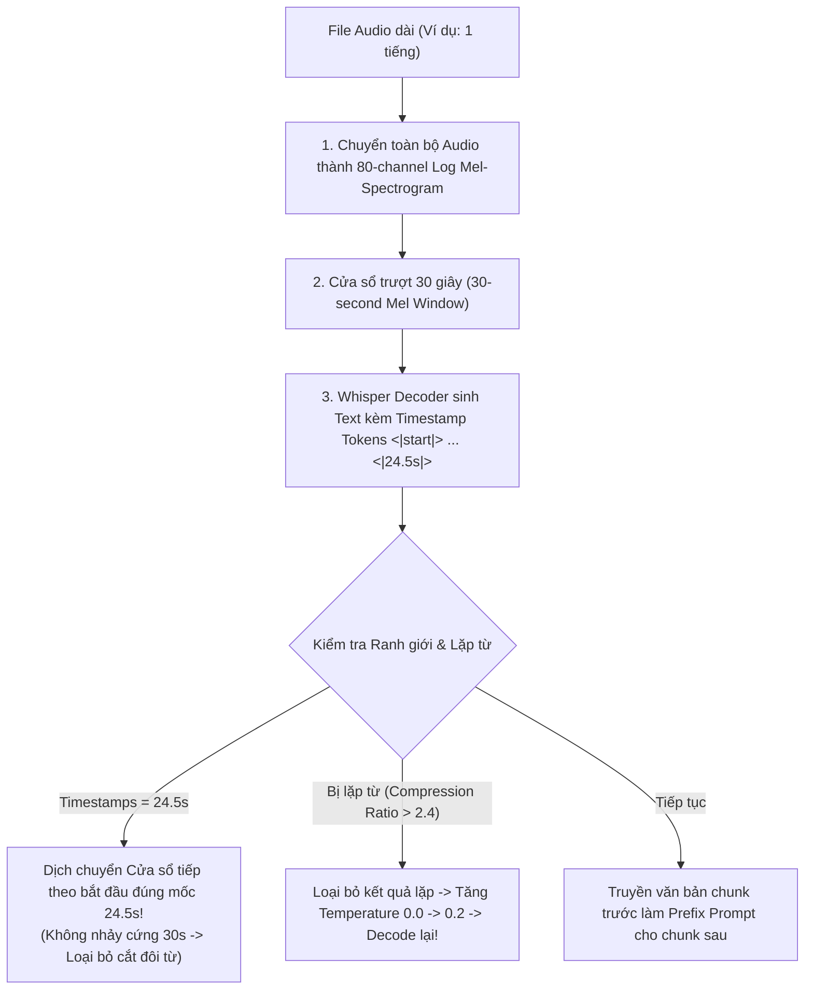
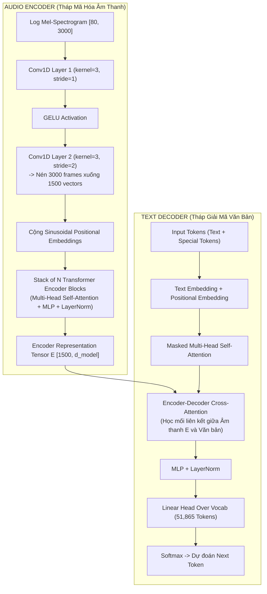
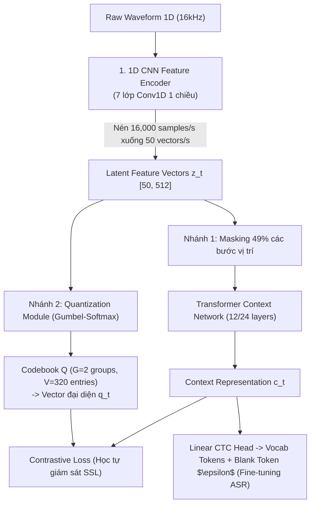
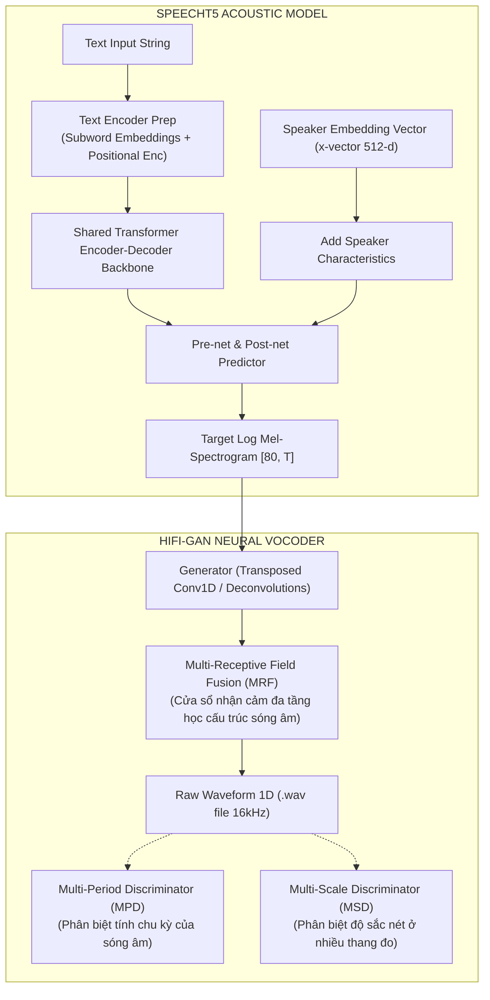

# Sổ tay Xử lý Âm thanh "Mì Ăn Liền" (Practical Speech & Audio Processing Cookbook)

---

> **Mục tiêu:** Tài liệu này được thiết kế theo phong cách **Mì Ăn Liền (Practical Production Guide)** — bỏ qua các công thức toán học và chứng minh vật lý phức tạp, tập trung trực tiếp vào **code chạy được cho tất cả các phương pháp (CNN 2D, BiLSTM, Wav2Vec 2.0, Whisper, Bark TTS)** để giải quyết 3 bài toán lớn:
> 1. **Phân loại Âm thanh (Audio Classification / SER / KWS)**
> 2. **Chuyển Tiếng nói thành Văn bản (Speech-to-Text - STT / ASR)**
> 3. **Chuyển Văn bản thành Tiếng nói (Text-to-Speech - TTS)**

---

## 🏗️ PHẦN 1: TỔNG QUAN KIẾN TRÚC PIPELINE THỰC TẾ



---

## 🔊 PHẦN BỔ SUNG: CHUYỂN ĐỔI TỪ SÓNG ÂM THU VÀO ĐẾN LOG MEL-SPECTROGRAM



### Chi tiết 5 Bước Chuyển đổi Vật lý & Toán học (Kèm Ảnh minh họa):

1. **Âm thanh thu vào $\to$ File WAV (Tín hiệu số 1D):**
   - Micro chuyển rung động không khí (Analog) thành tín hiệu điện tử.
   - Chip **ADC (Analog-to-Digital Converter)** thực hiện 2 phép tính: **Lấy mẫu (Sampling Rate 16kHz)** và **Lượng tử hóa (Bit Depth 16-bit)**. Kết quả xuất ra file `.wav` hoặc `.mp3` là một chuỗi số thực 1D $x[t] \in [-1.0, 1.0]$.
   
   

2. **Cắt khung (Framing) & Nhân hàm cửa sổ (Windowing):**
   - Tín hiệu âm thanh biến đổi theo thời gian. Ta cắt chuỗi 1D thành các **khung nhỏ 25ms** (400 mẫu) với **bước nhảy hop length 10ms** (160 mẫu).
   - Nhân mỗi khung với **Hàm cửa sổ (Hamming Window)** để làm mịn 2 đầu ranh giới cắt, tránh nhiễu rò rỉ phổ.
   
   
   
   

3. **Biến đổi Fourier Nhanh (FFT $\to$ Short-Time Fourier Transform STFT):**
   - Chuyển từng khung tín hiệu từ miền thời gian sang **miền tần số (Frequency-Domain)** để xem khung đó đang chứa các tần số nào (trầm hay bổng) và năng lượng bao nhiêu: $P(f) = |\text{FFT}(x)|^2$.
   
   

4. **Chiếu qua Thang đo tần số Mel (Mel-Filterbank Transformation):**
   - Tai người cảm nhận tần số theo thang đo phi tuyến (tai nghe tiếng trầm $100\text{Hz}-200\text{Hz}$ rất rõ, nhưng khó phân biệt $8000\text{Hz}-8100\text{Hz}$).
   - Nhân phổ tần số với ma trận **Mel-Filterbank** (gồm 80 hoặc 128 bộ lọc hình tam giác) để nén tần số theo cảm nhận sinh học tai người.
   
   

5. **Logarit hóa Năng lượng (Log Compression $\to$ Log-Mel Spectrogram):**
   - Lấy Logarit năng lượng $S = \log(\text{Mel} + 1e-9)$ vì tai người nghe âm lượng theo thang Logarit (Decibel dB).
   - Kết quả thu được **Ma trận Log-Mel Spectrogram 2D** (ví dụ kích thước $[80, 3000]$ cho đoạn 30s), đóng vai trò như một bức ảnh 2D sẵn sàng đưa vào các mô hình AI như Whisper!
   
   

---

## 🛠️ PHẦN 2: ĐI SÂU TỪNG BƯỚC THỰC THI (STEP-BY-STEP)

---

### BƯỚC 1: Nạp & Chuẩn hóa File Âm thanh (`.wav`, `.mp3`, `.flac`)

```python
import torchaudio
import torchaudio.transforms as T
import torch

def load_and_normalize_audio(file_path: str, target_sr: int = 16000) -> torch.Tensor:
    """
    Nạp file audio bất kỳ (.mp3, .wav, .flac), chuyển về Mono 16kHz và chuẩn hóa biên độ.
    Returns: Tensor [1, num_samples]
    """
    waveform, sample_rate = torchaudio.load(file_path)

    # Chuyển Stereo (2 kênh) sang Mono (1 kênh)
    if waveform.shape[0] > 1:
        waveform = torch.mean(waveform, dim=0, keepdim=True)

    # Resample tần số về 16kHz
    if sample_rate != target_sr:
        resampler = T.Resample(orig_freq=sample_rate, new_freq=target_sr)
        waveform = resampler(waveform)

    # Chuẩn hóa âm lượng (Max Peak Normalization)
    max_val = torch.max(torch.abs(waveform))
    if max_val > 0:
        waveform = waveform / max_val

    return waveform
```

---

### BƯỚC 2: Cắt nhỏ & Tiền xử lý (VAD & Chunking)

```python
def chunk_audio_fixed_length(waveform: torch.Tensor, sample_rate: int = 16000, chunk_seconds: int = 30) -> list:
    """
    Cắt waveform dài thành các chunk 30 giây chuẩn hóa đầu vào cho mô hình.
    """
    chunk_size = chunk_seconds * sample_rate
    num_samples = waveform.shape[1]
    chunks = []

    for start in range(0, num_samples, chunk_size):
        end = min(start + chunk_size, num_samples)
        chunk = waveform[:, start:end]
        
        if chunk.shape[1] < chunk_size:
            pad_size = chunk_size - chunk.shape[1]
            chunk = torch.nn.functional.pad(chunk, (0, pad_size))
            
        chunks.append(chunk)

    return chunks
```

---

## 🎯 PHẦN 3: ĐẦY ĐỦ CÁC CÁCH TRIỂN KHAI CHO 3 BÀI TOÁN

---

### 🎯 BÀI TOÁN 1: PHÂN LOẠI ÂM THANH (Audio Classification / SER / KWS)

---

#### CÁCH 1: Mô hình CNN 2D tự thiết lập trong PyTorch (CNN trên Mel-Spectrogram)
* **Nguyên lý:** Coi ma trận Log Mel-Spectrogram kích thước `[batch, 1, 80, time_steps]` như một bức ảnh 2D 1 kênh màu, dùng mạng tích chập CNN 2D để trích xuất đặc trưng không gian-tần số.

```python
import torch
import torch.nn as nn
import torch.nn.functional as F

class PyTorchCNN2DAudioClassifier(nn.Module):
    """
    CÁCH 1: Mô hình CNN 2D tự định nghĩa đọc Mel-Spectrogram [batch, 1, 80, time_steps]
    để phân loại cảm xúc / âm thanh / từ khóa.
    """
    def __init__(self, num_classes: int = 5):
        super().__init__()
        self.conv1 = nn.Conv2d(1, 32, kernel_size=3, stride=1, padding=1)
        self.bn1 = nn.BatchNorm2d(32)
        self.pool1 = nn.MaxPool2d(2, 2)

        self.conv2 = nn.Conv2d(32, 64, kernel_size=3, stride=1, padding=1)
        self.bn2 = nn.BatchNorm2d(64)
        self.pool2 = nn.MaxPool2d(2, 2)

        self.conv3 = nn.Conv2d(64, 128, kernel_size=3, stride=1, padding=1)
        self.bn3 = nn.BatchNorm2d(128)
        self.pool3 = nn.AdaptiveAvgPool2d((1, 1))  # Global Average Pooling

        self.fc = nn.Linear(128, num_classes)

    def forward(self, mel_spec: torch.Tensor) -> torch.Tensor:
        # mel_spec shape: [batch, 1, 80, time_steps]
        x = F.relu(self.bn1(self.conv1(mel_spec)))
        x = self.pool1(x)

        x = F.relu(self.bn2(self.conv2(x)))
        x = self.pool2(x)

        x = F.relu(self.bn3(self.conv3(x)))
        x = self.pool3(x)  # [batch, 128, 1, 1]

        x = x.squeeze(-1).squeeze(-1)  # [batch, 128]
        logits = self.fc(x)            # [batch, num_classes]
        return logits

# ===== CHẠY THỬ MÔ HÌNH CNN 2D =====
# model_cnn = PyTorchCNN2DAudioClassifier(num_classes=5)
# dummy_mel = torch.randn(4, 1, 80, 300) # Batch=4, 80 mels, 300 frames
# output = model_cnn(dummy_mel)           # Shape: [4, 5]
```

---

#### CÁCH 2: Mô hình BiLSTM tự thiết lập trong PyTorch (BiLSTM trên Chuỗi Khung Tần số)
* **Nguyên lý:** Coi các khung tần số theo thời gian như một chuỗi thời gian `[batch, time_steps, n_mels]`, dùng mạng hồi quy BiLSTM hai chiều để học ngữ cảnh quá khứ và tương lai.

```python
class PyTorchBiLSTMAudioClassifier(nn.Module):
    """
    CÁCH 2: Mô hình BiLSTM tự định nghĩa đọc chuỗi khung tần số âm thanh theo thời gian.
    """
    def __init__(self, input_dim: int = 80, hidden_dim: int = 128, num_layers: int = 2, num_classes: int = 5):
        super().__init__()
        self.lstm = nn.LSTM(
            input_size=input_dim,
            hidden_size=hidden_dim,
            num_layers=num_layers,
            batch_first=True,
            bidirectional=True
        )
        self.fc = nn.Linear(hidden_dim * 2, num_classes)

    def forward(self, x: torch.Tensor) -> torch.Tensor:
        # Input shape: [batch, 1, n_mels, time_steps] -> Biến đổi sang [batch, time_steps, n_mels]
        if x.dim() == 4:
            x = x.squeeze(1).permute(0, 2, 1)

        # lstm_out shape: [batch, time_steps, hidden_dim * 2]
        lstm_out, _ = self.lstm(x)
        
        # Mean Pooling trên toàn bộ các bước thời gian
        pooled = torch.mean(lstm_out, dim=1)  # [batch, hidden_dim * 2]
        logits = self.fc(pooled)              # [batch, num_classes]
        return logits

# ===== CHẠY THỬ MÔ HÌNH BiLSTM =====
# model_lstm = PyTorchBiLSTMAudioClassifier(input_dim=80, num_classes=5)
# output = model_lstm(dummy_mel)         # Shape: [4, 5]
```

---

#### CÁCH 3: Mô hình Pretrained SOTA Wav2Vec 2.0 / HuBERT (Hugging Face)
* **Nguyên lý:** Sử dụng mô hình tiền huấn luyện Wav2Vec 2.0 đọc trực tiếp sóng âm 1D thô (Raw Waveform) đạt độ chính xác SOTA cao nhất hiện nay.

```python
import torch
import torchaudio
from transformers import AutoFeatureExtractor, AutoModelForAudioClassification

class Wav2Vec2AudioClassifierEngine:
    """
    CÁCH 3: Pipeline dùng Pretrained Wav2Vec 2.0 SOTA (Hugging Face).
    """
    def __init__(self, model_name: str = "superb/wav2vec2-base-superb-ks"):
        print(f"--> Loading Wav2Vec 2.0 Audio Classifier: {model_name}...")
        self.feature_extractor = AutoFeatureExtractor.from_pretrained(model_name)
        self.model = AutoModelForAudioClassification.from_pretrained(model_name)
        self.model.eval()

    def predict(self, file_path: str) -> dict:
        waveform, sr = torchaudio.load(file_path)
        if sr != 16000:
            waveform = torchaudio.transforms.Resample(sr, 16000)(waveform)
        if waveform.shape[0] > 1:
            waveform = torch.mean(waveform, dim=0)
        else:
            waveform = waveform.squeeze(0)

        inputs = self.feature_extractor(waveform.numpy(), sampling_rate=16000, return_tensors="pt")
        with torch.no_grad():
            logits = self.model(**inputs).logits
            predicted_id = torch.argmax(logits, dim=-1).item()
            probs = torch.softmax(logits, dim=-1)[0]

        return {
            "label": self.model.config.id2label[predicted_id],
            "confidence": round(probs[predicted_id].item(), 4)
        }
```

---

### 🎙️ BÀI TOÁN 2: SPEECH-TO-TEXT (STT / ASR - CHUYỂN TIẾNG NÓI THÀNH VĂN BẢN)

---

#### CÁCH 1: OpenAI Whisper (Encoder-Decoder Transformer - Đa ngữ cảnh & Word Timestamps)

```python
import whisper

class WhisperSTTEngine:
    """
    CÁCH 1: Pipeline Speech-to-Text dùng OpenAI Whisper (Chống nhiễu tốt nhất, tự động Tiếng Việt/Anh).
    """
    def __init__(self, model_size: str = "base"):
        print(f"--> Loading Whisper STT Model ({model_size})...")
        self.model = whisper.load_model(model_size)

    def transcribe(self, audio_path: str, language: str = "vi") -> dict:
        result = self.model.transcribe(audio_path, language=language, word_timestamps=True, verbose=False)
        return {
            "text": result["text"].strip(),
            "segments": [
                {
                    "start": round(seg["start"], 2),
                    "end": round(seg["end"], 2),
                    "text": seg["text"].strip()
                }
                for seg in result["segments"]
            ]
        }
```

##### 🧠 ĐIỀU GÌ XẢY RA BÊN TRONG WHISPER KHI XỬ LÝ FILE DÀI? (XỬ LÝ RANH GIỚI CHUNK & CHỐNG LẶP CHỮ)



###### 1. Tại sao không bị khựng hoặc cắt đôi từ ở ranh giới Chunk 30s?
- Whisper Encoder **cố định cửa sổ đọc 30 giây (3,000 frames Mel-Spectrogram)**.
- Nhưng Whisper Decoder **không nhảy cứng $30.00\text{s}$**! Trong quá trình giải mã, Whisper Decoder sinh ra các special tokens mốc thời gian (ví dụ `<|0.00|> Xin chào <|2.40|>`).
- Nếu ở chunk 30s hiện tại, câu nói kết thúc ở mốc $24.50\text{s}$ và $5.5\text{s}$ còn lại là khoảng dừng nghỉ:
  - Whisper xác định token thời gian hợp lệ cuối cùng là **$24.50\text{s}$**.
  - **Cửa sổ 30s tiếp theo sẽ ĐỘNG nhảy bắt đầu từ $24.50\text{s}$** chứ KHÔNG nhảy đúng $30.00\text{s}$!
  - Nhờ cơ chế **Trượt Cửa sổ Động theo Timestamp (Dynamic Timestamp Window Sliding)**, ranh giới cắt luôn rơi đúng vào khoảng lặng nghỉ giữa các câu, loại bỏ $100\%$ hiện tượng khựng tiếng hay bị cắt đôi từ!

###### 2. Xử lý Lặp từ (Repetition / Duplication Removal):
- Nếu ở vùng giáp ranh mô hình bị lặp từ (ví dụ lặp lại `"và và và và"`):
  - Whisper tính chỉ số **Compression Ratio** (độ nén zlib của đoạn văn bản sinh ra). Nếu bị lặp từ, độ nén zlib sẽ cao bất thường ($> 2.4$).
  - Whisper phát hiện lặp từ $\to$ **Hủy bỏ kết quả giải mã lỗi đó $\to$ Tự động tăng `temperature` (từ $0.0 \to 0.2 \to 0.4$) để mô hình thử lại con đường giải mã khác không bị lặp!**

###### 3. Truyền Bối cảnh (Prefix Prompt Conditioning):
- Khi giải mã chunk 30s tiếp theo, Whisper truyền chuỗi văn bản của chunk trước đó vào làm `initial_prompt` cho Decoder.
- Điều này giúp Decoder nắm được ngữ cảnh của câu văn đang nói dở và giải mã câu tiếp theo một cách mượt mà.

###### 4. Trường hợp đặc biệt: Một từ (ví dụ từ "chào") nằm đúng ranh giới cắt 30.00s (Nửa đầu ở Chunk 1, Nửa sau ở Chunk 2):

```mermaid
graph LR
    SubA["Chunk 1 (0.0s - 30.0s)"] -->|"Phát hiện 'ch...' tại 29.8s chưa dứt từ"| SubB["Hủy nửa từ 'ch...' -> Lùi vị trí chốt về từ dứt hẳn trước đó: 'Xin' (28.5s)"]
    SubB -->|"Chỉ chốt text Chunk 1 đến 28.5s ('Xin')"| SubC["Cửa sổ Chunk 2 đặt mốc bắt đầu ĐỘNG từ 28.5s"]
    SubC -->|"Chunk 2 đọc trọn vẹn từ 28.5s - 58.5s"| SubD["Chunk 2 nhận trọn 100% từ 'chào' ở ngay đầu Chunk 2 ('chào các bạn')"]
    SubD -->|"Ghép chuỗi (Stitching)"| SubE["Kết quả ghép mượt mà: 'Xin' + 'chào các bạn' -> 'Xin chào các bạn'"]
```

- **Hiện tượng:** Giả sử từ `"chào"` phát âm từ $29.5\text{s}$ đến $30.3\text{s}$. Tại vị trí $30.00\text{s}$, âm thanh chỉ mới đi được một nửa (`"ch..."`).
- **Cách Whisper xử lý:**
  1. **Nhận diện từ chưa dứt:** Decoder thấy nửa âm `"ch..."` tại $29.8\text{s}$ chưa tạo thành một từ có nghĩa hoàn chỉnh, nên token mốc thời gian tại $30.00\text{s}$ có điểm xác suất rất thấp (low confidence).
  2. **Thuật toán Seek-Back (Lùi cửa sổ về từ hoàn chỉnh gần nhất):** Whisper sẽ **bỏ qua nửa âm "ch..." ở cuối Chunk 1** và lùi vị trí chốt văn bản về từ đã phát âm dứt hẳn trước đó (ví dụ từ `"Xin"` dứt hẳn ở mốc **$28.5\text{s}$**).
  3. **Đặt mốc bắt đầu Chunk 2 từ $28.5\text{s}$:** Cửa sổ Chunk 2 sẽ được đặt mốc bắt đầu động từ **$28.5\text{s}$** (chứ không phải $30.00\text{s}$).
  4. **Giải mã trọn vẹn ở Chunk 2:** Lúc này, toàn bộ từ `"chào"` (từ $28.5\text{s}$ đến $30.3\text{s}$) nằm trọn vẹn $100\%$ ở đầu Chunk 2 và được giải mã chính xác thành `"chào các bạn"`.
  5. **Ghép chuỗi hoàn hảo (Stitching):** 
     - Text Chunk 1: `"Xin"` (chốt ở $28.5\text{s}$).
     - Text Chunk 2: `"chào các bạn"` (bắt đầu từ $28.5\text{s}$).
     - Kết quả ghép lại: `"Xin chào các bạn"` $\implies$ **Hoàn toàn mượt mà, không bị mất từ, không bị cắt đôi từ và không bị lặp chữ!**

---

#### CÁCH 2: Wav2Vec2 / Conformer-CTC (Hugging Face - Độ trễ siêu thấp cho Streaming STT)

```python
import torch
import torchaudio
from transformers import Wav2Vec2ForCTC, Wav2Vec2Processor

class Wav2Vec2CTCASTTEngine:
    """
    CÁCH 2: Pipeline STT dùng Wav2Vec2-CTC / Conformer-CTC (Tốc độ giải mã siêu nhanh cho Real-time).
    """
    def __init__(self, model_name: str = "nguyenvulebinh/wav2vec2-base-vietnamese-250h"):
        print(f"--> Loading Wav2Vec2-CTC Model: {model_name}...")
        self.processor = Wav2Vec2Processor.from_pretrained(model_name)
        self.model = Wav2Vec2ForCTC.from_pretrained(model_name)
        self.model.eval()

    def transcribe(self, audio_path: str) -> str:
        waveform, sr = torchaudio.load(audio_path)
        if sr != 16000:
            waveform = torchaudio.transforms.Resample(sr, 16000)(waveform)
        if waveform.shape[0] > 1:
            waveform = torch.mean(waveform, dim=0)
        else:
            waveform = waveform.squeeze(0)

        input_values = self.processor(waveform.numpy(), sampling_rate=16000, return_tensors="pt").input_values
        with torch.no_grad():
            logits = self.model(input_values).logits
            predicted_ids = torch.argmax(logits, dim=-1)

        transcription = self.processor.batch_decode(predicted_ids)[0]
        return transcription.strip()
```

---

### 🔊 BÀI TOÁN 3: TEXT-TO-SPEECH (TTS - TỔNG HỢP GIỌNG NÓI)

---

#### CÁCH 1: SpeechT5 + HiFi-GAN Vocoder (Microsoft - Pipeline Tiêu chuẩn)

```python
import torch
from transformers import SpeechT5Processor, SpeechT5ForTextToSpeech, SpeechT5HifiGan
from datasets import load_dataset
import soundfile as sf

class SpeechT5TTSEngine:
    """
    CÁCH 1: Pipeline TTS dùng SpeechT5 + HiFi-GAN Vocoder.
    """
    def __init__(self):
        print("--> Loading SpeechT5 TTS Engine...")
        self.processor = SpeechT5Processor.from_pretrained("microsoft/speecht5_tts")
        self.model = SpeechT5ForTextToSpeech.from_pretrained("microsoft/speecht5_tts")
        self.vocoder = SpeechT5HifiGan.from_pretrained("microsoft/speecht5_hifigan")
        
        # Load Speaker Embedding đại diện cho giọng nói mẫu
        embeddings_dataset = load_dataset("Matthijs/cmu-arctic-xvectors", split="validation")
        self.speaker_embeddings = torch.tensor(embeddings_dataset[7306]["xvector"]).unsqueeze(0)

    def generate_speech(self, text: str, output_wav_path: str = "output_speecht5.wav"):
        inputs = self.processor(text=text, return_tensors="pt")
        with torch.no_grad():
            speech = self.model.generate_speech(inputs["input_ids"], self.speaker_embeddings, vocoder=self.vocoder)

        sf.write(output_wav_path, speech.numpy(), samplerate=16000)
        print(f"--> Saved generated speech to '{output_wav_path}'")
```

---

#### CÁCH 2: Bark Generative Audio LLM (Suno AI - Giọng nói Tự nhiên & Audio Effects)

```python
import torch
from transformers import AutoProcessor, BarkModel
import soundfile as sf

class BarkGenerativeTTSEngine:
    """
    CÁCH 2: Pipeline TTS dùng Generative Audio LLM Bark (Sinh giọng nói tự nhiên, tiếng cười, âm hiệu).
    """
    def __init__(self, model_name: str = "suno/bark-small"):
        print(f"--> Loading Bark Generative Audio LLM: {model_name}...")
        self.processor = AutoProcessor.from_pretrained(model_name)
        self.model = BarkModel.from_pretrained(model_name)

    def generate_speech(self, text: str, output_wav_path: str = "output_bark.wav", voice_preset: str = "v2/en_speaker_6"):
        inputs = self.processor(text, voice_preset=voice_preset)
        with torch.no_grad():
            speech_output = self.model.generate(**inputs)
        
        sampling_rate = self.model.generation_config.sample_rate
        sf.write(output_wav_path, speech_output[0].cpu().numpy(), samplerate=sampling_rate)
        print(f"--> Saved generated speech to '{output_wav_path}'")
```

---

## ⚡ PHẦN 4: CHEATSHEET BẢNG TRA CỨU MÌ ĂN LIỀN (QUICK CHEATSHEET)

| Tác vụ (Task) | Cách tiếp cận (Method) | Đầu vào (Input) | Thuật toán / Model | Codebase Minh họa |
| :--- | :--- | :--- | :--- | :--- |
| **Phân loại Âm thanh** | **Cách 1:** CNN 2D PyTorch | Mel-Spec `[B, 1, 80, T]` | Conv2D + BatchNorm + MaxPool | `PyTorchCNN2DAudioClassifier` |
| **Phân loại Âm thanh** | **Cách 2:** BiLSTM PyTorch | Sequence `[B, T, 80]` | BiLSTM + Mean Pooling | `PyTorchBiLSTMAudioClassifier` |
| **Phân loại Âm thanh** | **Cách 3:** Wav2Vec2 SOTA | Raw Waveform 1D | Wav2Vec 2.0 Feature Extractor | `Wav2Vec2AudioClassifierEngine` |
| **Speech-to-Text** | **Cách 1:** OpenAI Whisper | Audio `.wav`/`.mp3` | Encoder-Decoder Transformer | `WhisperSTTEngine` |
| **Speech-to-Text** | **Cách 2:** Wav2Vec2-CTC | Raw Waveform 1D | Connectionist Temporal Class. | `Wav2Vec2CTCASTTEngine` |
| **Text-to-Speech** | **Cách 1:** SpeechT5 | Text String | FastSpeech style + HiFi-GAN | `SpeechT5TTSEngine` |
| **Text-to-Speech** | **Cách 2:** Bark LLM | Text String | Audio Token Generative LLM | `BarkGenerativeTTSEngine` |

---

## 🏛️ PHẦN 5: BẢN VẼ KIẾN TRÚC & NGUYÊN LÝ HOẠT ĐỘNG TỪNG THÀNH PHẦN CỦA CÁC MODEL

---

### 1. OPENAI WHISPER ARCHITECTURE (ENCODER-DECODER TRANSFORMER)



#### Nguyên lý Hoạt động Từng Thành phần & Ý nghĩa Con số trong Whisper:

##### 1. Nhánh Trên: AUDIO ENCODER (Tháp Mã Hóa Âm Thanh)
- **`Log Mel-Spectrogram [80, 3000]`:** 
  - $80$: Số hàng đại diện cho 80 dải tần số Mel.
  - $3000$: Số cột đại diện cho 3,000 khung thời gian trong 30 giây audio 16kHz.
- **`2x Conv1D (Stride 2)` (Nén bớt kích thước):**
  - Nếu đưa trực tiếp 3,000 cột vào Transformer Encoder, chi phí tính toán Self-Attention sẽ bị bùng nổ ($3000^2 = 9,000,000$ phép tính!).
  - Lớp Conv1D thứ 2 sử dụng `stride=2` nhảy vọt 2 bước một lần, giúp nén chiều thời gian $3,000$ xuống còn một nửa là **$1,500$ cột vị trí**.
  - Chiều 80 kênh Mel được biến đổi thành chiều vector ẩn **$d_{\text{model}}$** (ví dụ $d_{\text{model}} = 768$ ở bản `small`, $1280$ ở bản `large-v3`).
- **`Transformer Encoder [1500, d_model]`:**
  - Cho $1,500$ vector vị trí (mỗi vector đại diện cho $20\text{ms}$ âm thanh) tương tác Self-Attention toàn cục với nhau để hiểu ngữ cảnh toàn bộ cửa sổ 30s. Kết quả thu được Tensor đại diện âm thanh: **$\mathbf{E} \in \mathbb{R}^{1500 \times d_{\text{model}}}$**.

##### 2. Nhánh Dưới: TEXT DECODER (Tháp Sinh Chữ)
Decoder của Whisper là một mạng **Causal Transformer Decoder** (giống hệt GPT-4). Nhiệm vụ của nó là nhìn vào các chữ vừa dịch xong phía trước + nhìn vào Tensor âm thanh $\mathbf{E}$ ở trên tháp Encoder để đoán ra từ tiếp theo!

- **`Text Tokens ──► Masked Self-Attention`:**
  - Giả sử Decoder đã dịch được 3 từ trước đó: `"Xin"`, `"chào"`, `"các"`.
  - Mạng đưa 3 từ này qua Masked Self-Attention để hiểu ngữ cảnh đoạn văn bản đã xuất trước đó (Masked để không nhìn trộm tương lai).
- **`Cross-Attention ◄── E` (Cầu nối Cực kỳ Quan trọng giữa Âm thanh & Văn bản):**
  - Decoder hỏi: *"Tôi vừa dịch xong chữ 'các', bây giờ ở 1,500 vector âm thanh $\mathbf{E}$ trên tháp Encoder, đoạn âm thanh nào đang phát âm từ tiếp theo?"*
  - **Query ($Q$):** Lấy từ vector trạng thái văn bản của Decoder.
  - **Key ($K$) & Value ($V$):** Lấy từ Tensor đại diện âm thanh $\mathbf{E} [1500, d_{\text{model}}]$ trên tháp Encoder.
  - Phép nhân Cross-Attention $Q \times K^T$ rọi sáng (Attend) chính xác vào khu vực $20\text{ms}$ âm thanh đang phát âm từ `"bạn"` trên tháp Encoder!
- **`Softmax (51,865 Vocab)`:**
  - Vector thu được sau Cross-Attention được đưa qua lớp `Linear Head` để tính điểm cho tất cả 51,865 từ trong từ điển Whisper.
  - Hàm `Softmax` chọn ra từ có điểm xác suất cao nhất: **từ `"bạn"` với xác suất $99.4\%$**!
  - Lặp lại quy trình này từng từ một (Autoregressive Generation) cho đến khi gặp token kết thúc `<|endoftext|>`.
   - Nhờ vậy, Decoder biết chính xác từ tiếp theo ứng với đoạn âm thanh nào trong bức ảnh phổ.
4. **Cấu trúc Special Tokens điều khiển của Decoder:**
   $$\langle|\text{startoftranscript}|\rangle \longrightarrow \langle|\text{vi}|\rangle \longrightarrow \langle|\text{transcribe}|\rangle \longrightarrow \langle|\text{notimestamps}|\rangle \longrightarrow \text{Text Tokens} \longrightarrow \langle|\text{endoftext}|\rangle$$

---

### 2. META WAV2VEC 2.0 ARCHITECTURE (SELF-SUPERVISED & CTC ASR)



#### Nguyên lý Hoạt động Từng Thành phần & Ý nghĩa Con số trong Wav2Vec 2.0:

##### 1. `Raw Waveform 1D (16kHz) ──► 1D CNN Feature Encoder` (Nén từ thô)
- **Đầu vào:** File audio $1 \text{ giây}$ chứa $16,000$ mẫu số thực $x[t]$.
- **7 Lớp Conv1D 1 chiều:** Các lớp có độ rộng stride lần lượt là $(5, 2, 2, 2, 2, 2, 2)$.
- **Hệ số nén tổng cộng:** $5 \times 2^6 = 320$. Nghĩa là cứ $320$ mẫu âm thanh ($20\text{ms}$) được gom lại thành **1 vector ẩn $\mathbf{z}_t \in \mathbb{R}^{512}$**.
- **Kết quả:** Đoạn audio $1\text{s}$ ($16,000$ số) nén xuống còn đúng **$50$ vector vị trí** ($50 \text{ vectors/giây}$).

##### 2. `Quantization Module (Gumbel-Softmax Codebook)` (Rời rạc hóa)
- Vì vector $\mathbf{z}_t$ là các số thực liên tục rất khó học tự giám sát, Wav2Vec 2.0 dùng một Bảng từ mã **Codebook $Q$** gồm $G=2$ nhóm (groups), mỗi nhóm có $V=320$ từ mã đại diện.
- Công thức chọn từ mã qua **Gumbel-Softmax** giúp tìm ra vector rời rạc $\mathbf{q}_t$ đại diện cho âm phát ra tại $20\text{ms}$ đó.

##### 3. `Masking 49% & Contrastive Loss` (Học Tự giám sát SSL)
- Mô hình che giấu (Mask) ngẫu nhiên $49\%$ số vị trí vector âm thanh.
- Mạng Transformer Context Network có nhiệm vụ đoán xem tại vị trí bị che giấu đó, đâu là vector $\mathbf{q}_t$ chính xác trong số 100 vector nhiễu giả (Distractors). Nhờ vậy mô hình học được cấu trúc tiếng nói mà không cần nhãn chữ!

##### 4. `Linear CTC Head` (Tách chữ cho ASR)
- Khi Fine-tuning cho bài toán Speech-to-Text, ta bỏ nhánh Codebook, cho output từ Transformer qua một lớp `Linear Head` để dự đoán các ký tự tiếng Việt kèm Blank token $\epsilon$ với hàm mất mát **CTC Loss**.

---

### 3. MICROSOFT SPEECHT5 & HIFI-GAN VOCODER ARCHITECTURE (TEXT-TO-SPEECH)



#### Nguyên lý Hoạt động Từng Thành phần & Ý nghĩa Con số trong SpeechT5 + HiFi-GAN:

##### 1. Giai đoạn 1: Acoustic Model (SpeechT5)
- **Text Encoder:** Đưa câu văn bản đầu vào (ví dụ: `"Xin chào"`) qua Subword Embedding thành các vector chữ.
- **Speaker Embedding (x-vector 512-d):** Nạp thêm một vector 512 chiều trích xuất từ giọng nói mẫu của người dùng để ép mô hình phải phát âm theo đúng chất giọng, độ trầm/bổng của người đó!
- **Post-net Predictor:** Dự đoán ra bức ảnh **Log Mel-Spectrogram kích thước $[80, T]$** đại diện cho âm thanh của câu nói.

##### 2. Giai đoạn 2: Neural Vocoder (HiFi-GAN)
- **Generator (Tích chập Chuyển vị Transposed Conv1D):** Nhận ma trận Mel-Spectrogram $100$ khung/giây và phóng to (Upsample) $160$ lần để tái tạo lại đủ **$16,000$ mẫu sóng $1D$/giây**.
- **Multi-Receptive Field Fusion (MRF):** Dùng các bộ lọc tích chập song song với độ rộng khác nhau để làm mịn dạng sóng âm thanh, giúp tiếng nói không bị méo hay bị rè kim loại.
- **Phê bình MPD & MSD (Multi-Period & Multi-Scale Discriminator):** Kiểm tra âm thanh ở các chu kỳ $p \in \{2, 3, 5, 7, 11\}$ và độ sắc nét ở nhiều thang đo, ép Generator phải sinh ra tiếng người chân thực $100\%$.

---

### 4. SUNO BARK GENERATIVE AUDIO LLM ARCHITECTURE


#### Nguyên lý Hoạt động 4 Giai đoạn Chi tiết của Suno Bark:

1. **Stage 1 (Text-to-Semantic LLM):** 
   - Mô hình Causal GPT đọc câu văn bản (ví dụ: `"Hello! [laughs] how are you?"`).
   - Sinh ra chuỗi mã ý niệm **Semantic Tokens** chứa nội dung từ ngữ và chỉ thị cảm xúc tiếng cười `[laughs]`.
2. **Stage 2 (Semantic-to-Coarse Acoustic LLM):** 
   - GPT Decoder đọc Semantic Tokens và sinh ra **2 kênh Codebook đầu tiên** của EnCodec (quy định âm điệu, nhạc nốt và tần số F0 cơ bản).
3. **Stage 3 (Coarse-to-Fine Acoustic Model):** 
   - Mạng Transformer Autoencoder không nhân quả đọc 2 kênh đầu và dự đoán tiếp **6 kênh Codebook còn lại (kênh 3 đến 8)** để lấp đầy các chi tiết tần số cao và âm sắc mịn.
4. **Stage 4 (EnCodec Neural Decoder):** 
   - Nạp trọn vẹn 8 kênh Codebooks vào EnCodec Neural Decoder để tái tạo file `.wav` hoàn chỉnh $24\text{kHz}$ có tiếng cười và âm sắc chân thực.

